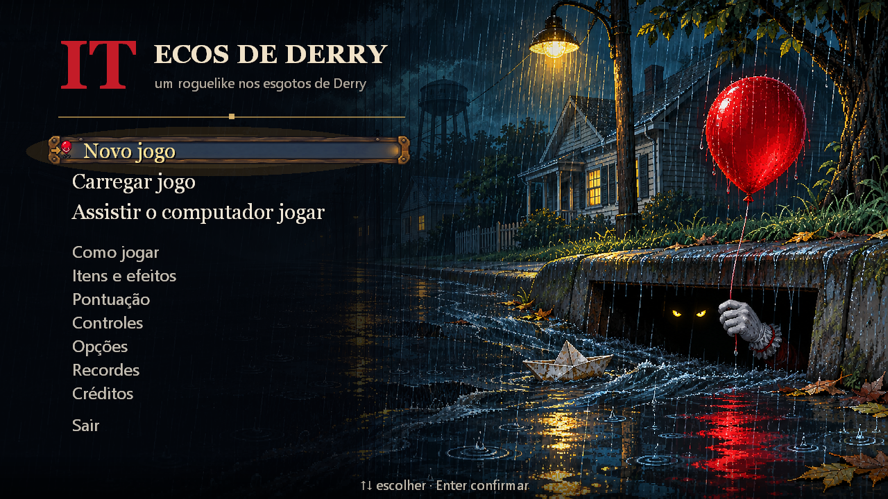
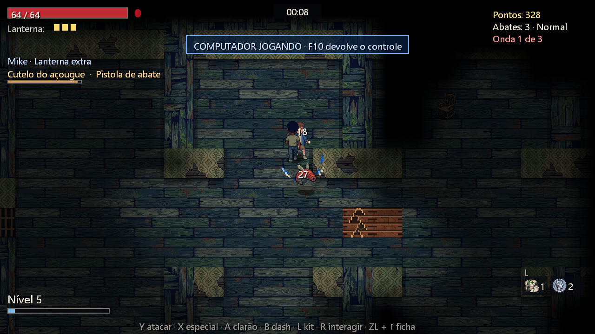
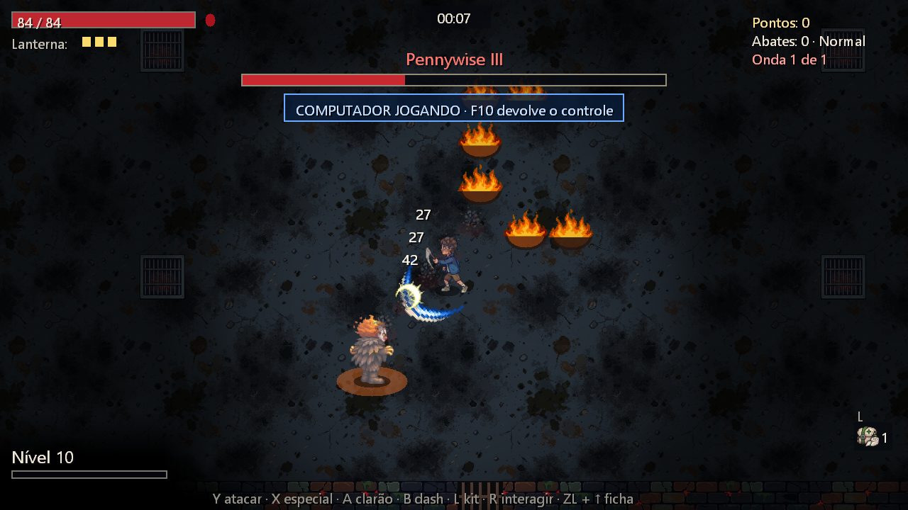
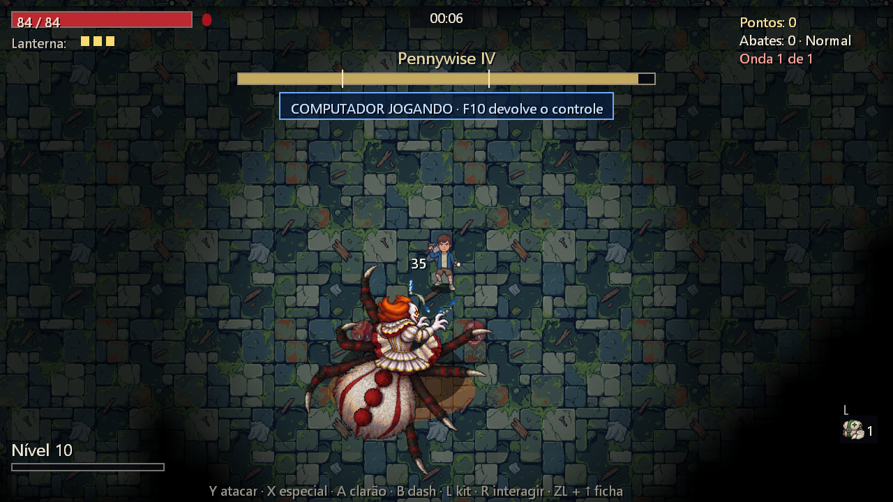
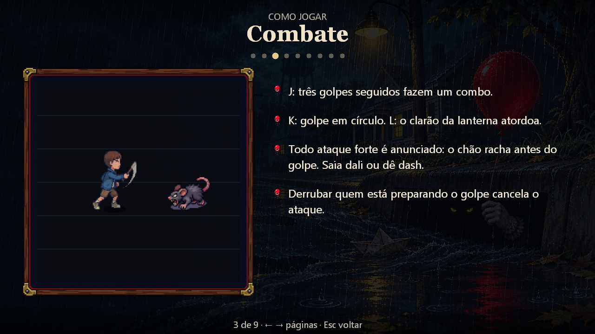
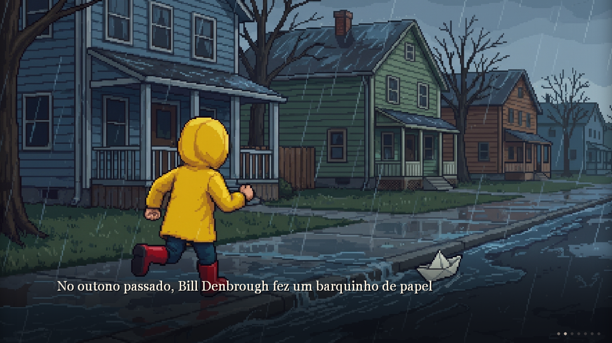

# IT: Ecos de Derry

**Roguelike de ação em pixel art, escrito do zero em C++17 puro, sem engine.**
Derry, Maine, 1989. Os amigos de Bill Denbrough sumiram nos esgotos da cidade, cada um preso por um medo.
Desça pelos sete biomas, enfrente os medos e o Pennywise que sai de dentro de cada um, liberte os Perdedores
e derrote a forma verdadeira da Coisa no Covil.

Trabalho T3 de **Algoritmos e Programação II (UNIVALI)**, por **Diego Silva**.

**[Jogue no navegador em ecosdederry.click](https://ecosdederry.click/)** · **[Leia a história completa na wiki ilustrada](https://diegof-d2fs.github.io/it-ecos-de-derry/)**



| | |
|---|---|
|  |  |
|  |  |



---

## Sumário

- [O jogo](#o-jogo)
- [Destaques técnicos](#destaques-técnicos)
- [Como compilar e rodar](#como-compilar-e-rodar)
- [Controles](#controles)
- [Opções de linha de comando](#opções-de-linha-de-comando)
- [Testes e o computador jogando sozinho](#testes-e-o-computador-jogando-sozinho)
- [Estrutura do projeto](#estrutura-do-projeto)
- [Arte, som e pipeline de assets](#arte-som-e-pipeline-de-assets)
- [Documentação](#documentação)
- [Créditos e aviso legal](#créditos-e-aviso-legal)

---

## O jogo

- **Sete biomas** gerados a cada tentativa: Galeria pluvial, Os Barrens, Casa da Rua Neibolt, Porões inundados,
  Siderúrgica Kitchener, Cisterna das vozes e o Covil. 97 salas desenhadas à mão em texto (`data/salas`), sorteadas
  e encadeadas pelo gerador.
- **Combate em tempo real**: combo de três golpes com o taco, golpe especial em círculo, clarão da lanterna que
  atordoa e **dash invulnerável**. Todo ataque forte é anunciado no chão antes de acontecer.
- **Escuridão de verdade**: a lanterna ilumina em volta do Bill (visão por *shadowcasting*); o que já foi visto fica
  na memória, mais escuro.
- **Sete chefes** com duas fases: o medo (Múmia, Afogado, Leproso, Ralo de Sangue, Pássaro das Cinzas, Lobisomem) e,
  a 50% da vida, o **Pennywise** que sai de dentro dele, diferente a cada estágio. O último é o **Pennywise IV, o
  palhaço-aranha**: corpo de aranha que gira em 360 graus, teia que prende, salto de aranha e as Luzes Mortas.
- **Os amigos lutam junto**: Mike, Ben, Stan, Eddie, Beverly e Richie acompanham o Bill, cada um com uma arma, um
  poder e um apoio ligados à sua história (o cutelo do açougue do Mike, a labareda da Beverly, o passarinho do Stan
  que aponta armadilhas...). Só ajudam com 2 ou mais inimigos na tela e nunca vencem a luta sozinhos.
- **Progresso que fica**: XP, níveis e quatro atributos (Força, Foco, Agilidade, Coragem), itens e inventário, Ecos
  (bênçãos de cada amigo), loja, baús, salas secretas, armadilhas, Pacto de Sangue (vida extra) e as Lembranças, que
  compram talentos para sempre no Mural do Clube dos Perdedores.
- **Três dificuldades** (Fácil, Normal, Difícil), pontuação com recordes e um cartão de memória com 15 blocos.
- **História contada em cenas ilustradas** (abertura, um capítulo por bioma e o epílogo).
- **Teclado e controle** (Xbox, 8BitDo, Switch Pro): todo texto de botão se adapta ao dispositivo em uso.

## Destaques técnicos

- **C++17 puro, sem engine nem framework de jogo.** As únicas bibliotecas externas são as do próprio Windows, e a
  SDL2 apenas para ler joysticks (carregada em tempo de execução).
- **Render por software**: canvas de pixels próprio (resolução lógica de 640 × 360, escalada para a tela), sprites com
  pivô, tinta, giro e esticamento, luz e escuridão, efeitos e partículas. O GDI só entrega os pixels e desenha o texto.
- **Áudio mixado no próprio código** (8 vozes + ambiente sobre o `waveOut`), músicas com *crossfade* entre faixas.
- **Regras separadas da plataforma**: a biblioteca `regras` (mundo, entidades, combate, jogo) não pode incluir nenhum
  cabeçalho do Windows. O CMake verifica isso ao configurar e falha se a fronteira for violada.
- **IA por tabela de ponteiros para função** (um comportamento por tipo de inimigo), padrões de ataque dos chefes como
  dados, caminhos por BFS.
- **Piloto automático**: o computador joga o jogo inteiro, do prólogo ao Covil, usando só os mesmos comandos de quem
  joga (não lê nada que o jogador não veja).
- **306 testes automáticos** das regras, sem abrir janela, incluindo o piloto limpando todas as salas reais.
- Cerca de 21 mil linhas de código do jogo e 8 mil de testes.

## Como compilar e rodar

**Requisitos (Windows 10/11):** [MSYS2](https://www.msys2.org/) com o toolchain UCRT64 e o CMake:

```bash
pacman -S mingw-w64-ucrt-x86_64-gcc mingw-w64-ucrt-x86_64-cmake make
```

**Compilar** (PowerShell, na pasta do projeto):

```powershell
$env:PATH = "C:\msys64\ucrt64\bin;$env:PATH"
cmake -S . -B build -G "MinGW Makefiles" -DCMAKE_BUILD_TYPE=Release
cmake --build build -j 8
```

**Rodar:**

```powershell
.\build\ecos_de_derry.exe          # o jogo (abre no menu)
.\build\testes_regras.exe          # os testes das regras, no console
```

O build copia `assets/jogo`, `assets/jogo_hd`, `assets/musics`, `data` e a `SDL2.dll` para a pasta do executável.
Os executáveis são estáticos: rodam em qualquer Windows sem instalar o MinGW. Para levar o jogo para outra máquina,
basta copiar a pasta `build` sem as subpastas `CMakeFiles`.

## Controles

| Ação | Teclado | Controle (Xbox) |
|---|---|---|
| Mover (8 direções) | WASD ou setas | analógico / direcional |
| Atacar (combo de 3) | J | X |
| Golpe especial | K | Y |
| Clarão da lanterna | L | B |
| Dash (invulnerável) | Espaço | A |
| Interagir | E | RB |
| Usar kit | Q | LB |
| Inventário | I ou Tab | Back |
| Ficha de atributos | C | LT + ↑ |
| Pausa | Esc ou P | Start |
| O computador joga (liga e desliga) | F10 | |
| Tela cheia | F11 | |

Em controles Nintendo (Switch Pro, 8BitDo no modo Switch), as letras seguem a posição dos botões, e o jogo mostra
as letras certas na tela.

## Opções de linha de comando

| Opção | O que faz |
|---|---|
| `--jogar` | pula o menu e começa uma tentativa |
| `--bioma-inicial N` | começa a tentativa no bioma N (1 a 7), com o Bill no nível de quem chegou ali |
| `--sala ID` | abre uma sala avulsa (o id é o nome do arquivo em `data/salas`, ex.: `b7_covil`) |
| `--forte` | na sala avulsa, o Bill chega como chegaria naquele ponto da tentativa |
| `--pennywise` | na arena de chefe, começa direto na fase do Pennywise |
| `--amigo NOME` | o amigo ao lado do Bill: `mike`, `ben`, `stan`, `eddie`, `beverly` ou `richie` |
| `--piloto` | o computador começa jogando (F10 devolve o controle) |
| `--dificuldade D` | `facil`, `normal` ou `dificil` |
| `--itens`, `--pontos N`, `--eco "Nome"` | começa com itens, pontos de atributo ou um Eco |
| `--cena ID` | abre uma cena da história (`abertura`, `bioma_2` … `bioma_7`, `final`) |
| `--seed N` | repete exatamente a mesma partida |
| `--simular N` | sem janela: o computador joga N tentativas inteiras e grava o resumo em `saves/` |
| `--captura arq.bmp --quadros N` | roda N quadros, salva a imagem e as métricas e fecha (testes visuais) |

Exemplos:

```powershell
.\build\ecos_de_derry.exe --sala b7_covil --forte            # o chefe final
.\build\ecos_de_derry.exe --bioma-inicial 5 --piloto         # o computador joga a partir da Siderúrgica
.\build\ecos_de_derry.exe --simular 30 --dificuldade dificil # 30 tentativas sem janela
```

## Testes e o computador jogando sozinho

```powershell
.\build\testes_regras.exe            # todos os testes
.\build\testes_regras.exe piloto     # só os que têm "piloto" no nome
```

Os testes cobrem combate, IA, chefes, itens, armadilhas, gerador de tentativas, salvamento, menus, a regra de que
nenhum texto de interface fixa uma tecla e o **piloto limpando cada sala real 10 vezes**. A simulação
(`--simular 30`) mede o equilíbrio: na versão atual o computador vence o jogo inteiro em 30 de 30 tentativas no
Fácil, 29 de 30 no Normal e 28 de 30 no Difícil.

## Estrutura do projeto

```
src/core         tipos, números aleatórios, entrada abstrata, manifesto, pixels, arquivos ┐
src/mundo        salas, tiles, colisão, visão (shadowcasting), caminhos (BFS)            │ biblioteca "regras":
src/entidades    jogador e inimigos (IA por tabela de ponteiros para função)             │ sem Windows,
src/combate      golpes, áreas, atributos, experiência                                   │ testável sem janela
src/jogo         partida, tentativa, chefes, amigos, itens, loja, piloto, salvamento…    ┘
src/render       canvas de pixels, PNG, sprites, texto, luz
src/plataforma   janela Win32, teclado, joystick (XInput / SDL2), áudio (waveOut + MCI)
src/cenas        menu, sala, Clube, inventário, cenas da história (tabela de ponteiros para função)
data/            salas (texto), diálogos, cenas, sons e o balanceamento das dificuldades
assets/jogo*     sprites e ilustrações exportados (1× e 4×) com o manifesto
assets/musics    músicas e efeitos
tests/           os testes das regras
tools/           scripts Python do pipeline de arte (geração, exportação, conferência)
web/             versão para navegador: página, conta e cartão na AWS (opcional), API e infraestrutura
wiki/            a wiki ilustrada da história, publicada no GitHub Pages
docs/            PRD, SDD, HANDOFF (diário do projeto) e as imagens deste README
instructions/    prompts de todos os assets
```

## Arte, som e pipeline de assets

A arte é pixel art gerada com IA a partir de prompts versionados em `instructions/Prompts-Assets-*.md` (gerados por
`tools/prompts_*.py`) e revisada imagem a imagem. O `tools/export_final.py` recorta as folhas pelos quadros, limpa o
fundo e exporta duas versões (1× e 4×) com o `manifesto.txt` que o jogo lê. Os originais em alta resolução não
ficam no repositório; o jogo usa só as versões exportadas em `assets/jogo` e `assets/jogo_hd`.

Músicas e efeitos sonoros vêm de bancos de áudio livres.

## Documentação

| Documento | Conteúdo |
|---|---|
| [`docs/HANDOFF.md`](docs/HANDOFF.md) | histórico de decisões e verificações; contém estados antigos |
| [`docs/PRD-v2-IT-Ecos-de-Derry.md`](docs/PRD-v2-IT-Ecos-de-Derry.md) | o produto: regras, conteúdo e critérios |
| [`docs/SDD-v1-IT-Ecos-de-Derry.md`](docs/SDD-v1-IT-Ecos-de-Derry.md) | o projeto técnico |
| [`docs/APRENDIZADOS.md`](docs/APRENDIZADOS.md) | o que deu certo e errado ao longo do desenvolvimento |
| [`docs/COMANDOS_DEMONSTRACAO.txt`](docs/COMANDOS_DEMONSTRACAO.txt) | roteiro e comandos para a apresentação |

## Créditos e aviso legal

**Criação, programação, design e direção:** Diego Silva.
**Assistência de programação:** Claude (Anthropic) e Codex (OpenAI).
**Joystick:** [SDL2](https://www.libsdl.org/) 2.30.9 (licença zlib), em `third_party/SDL2`.

Projeto acadêmico e sem fins lucrativos, feito como homenagem. *IT* e seus personagens pertencem a Stephen King e aos
respectivos detentores de direitos; este projeto não tem relação com eles.
